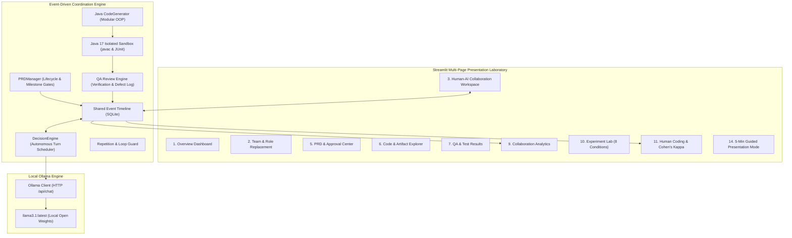

# ChatCollab: Human–AI Software Development Laboratory

[-blueviolet.svg)](https://arxiv.org/abs/2404.14399)
[](https://python.org)
[](https://streamlit.io)
[-orange.svg)](https://adoptium.net)
[-green.svg)](https://ollama.ai)

An enterprise-grade, event-driven **Human–AI Software Development Laboratory** faithfully inspired by the landmark research paper:
> **ChatCollab: Exploring Collaboration Between Humans and AI Agents in Software Teams** (Klieger et al., Stanford University / Harvard / CMU, 2024).

This system provides a complete research, simulation, and presentation environment running **100% locally on your machine** using Ollama (`llama3.1`) and Java 17, without requiring OpenAI API keys, paid subscriptions, or cloud infrastructure.

---

## 🏛️ System Architecture



---

## 🚀 Key Research Features & Innovations

1. **Small-Group Sociology Grounding (Bales IPA)**:
   - Systematically classifies conversational speech acts into Robert Bales' 12 interaction categories (*Shows Solidarity, Gives Suggestion, Gives Opinion, Gives Orientation, Asks for Orientation*, etc.).
   - Employs a **$\pm 2$ turn conversational context window** for high-precision classification.
   - Calculates **Pairwise Percentage Agreement** and **Cohen's Kappa ($\kappa$)** against human annotations (replicating the paper's benchmark of 78.1% agreement and $\kappa = 0.729$).

2. **Explicit Autonomous WAIT Actions**:
   - Unlike naive linear agent chains that suffer from hallucination cascades, ChatCollab agents evaluate timeline state and can deliberately choose `DecisionAction.WAIT`.
   - The Developer agent waits until the Product Manager has drafted the PRD and the CEO (or human) has granted milestone approval.

3. **Institutional Knowledge Injection**:
   - Injects organizational rules, stage-gate expectations, and behavioral guidelines directly into agent system prompts, eliminating conversational drift.

4. **Human Role Replacement (Mixed-Initiative)**:
   - Supports testing mixed teams: a human participant can act as Product Sponsor/Client, or directly replace the AI CEO, AI Product Manager, or AI Developer.

5. **Deterministic Java 17 Sandbox**:
   - Generated code is written to isolated per-project workspaces and compiled using `javac 17`.
   - Executes an automated unit test suite (`TicTacToeTest`) validating empty board states, moves, invalid move rejection, horizontal/vertical/diagonal wins, and draws.

6. **8 Experimental Conditions Lab**:
   - Replicates the paper's experimental designs (Baseline, Enthusiastic CEO, Aggressive PM, Cautious Dev, Human CEO replacement, etc.) with multi-run execution and CSV export.

---

## 📂 Project Structure

```
ssw625-ChatCollab/
├── app.py                         # Master Streamlit Application Entrypoint
├── requirements.txt               # Python package dependencies
├── README.md                      # Comprehensive user & research guide
├── chatcollab/
│   ├── core/                      # Core configuration, models, database, Ollama
│   │   ├── config.py              # System paths, timeouts, default models
│   │   ├── models.py              # Pydantic schemas (Events, Decisions, PRDs, QA, Bales IPA)
│   │   ├── database.py            # SQLite persistent storage & index manager
│   │   └── ollama_client.py       # Robust HTTP client with JSON extraction & healing
│   ├── agents/                    # Multi-agent roles and prompt engineering
│   │   ├── prompts.py             # Role prompts, institutional knowledge, persona modifiers
│   │   ├── base_agent.py          # Turn decision engine, history formatting, loop guards
│   │   └── roles.py               # TeamManager and human role replacement
│   ├── engine/                    # Software engineering workflow engines
│   │   ├── timeline.py            # Event bus broker and agent timeline cursors
│   │   ├── decision_engine.py     # Turn coordinator and action dispatcher
│   │   ├── prd_manager.py         # PRD generation, versioning, and approval gates
│   │   ├── code_generator.py      # Java 17 modular generator & workspace extractor
│   │   ├── sandbox.py             # Isolated javac compilation and unit test runner
│   │   └── qa_engine.py           # QA defect tracking and verification engine
│   ├── analytics/                 # Research evaluation modules
│   │   ├── bales_ipa.py           # 12-category Bales IPA classifier with context window
│   │   ├── human_coding.py        # Cohen's Kappa, Pairwise Agreement & Confusion Matrix
│   │   ├── metrics.py             # Collaboration metrics & paper baseline references
│   │   └── experiments.py         # 8 experimental condition runner & CSV exporter
│   └── ui/                        # Presentation & Dashboard Views (15 modules)
│       ├── styles.py              # Modern CSS dark-mode styling & cards
│       ├── components.py          # KPI metrics, badges, event chat bubbles
│       └── views/                 # 15 dedicated view modules (view_dashboard, etc.)
├── tests/                         # Pytest automated test suite
└── workspaces/                    # Isolated execution sandboxes for Java projects
```

---

## 🛠️ Prerequisites & Installation

### 1. Python Environment
Python 3.11, 3.12, or 3.13 is supported:
```powershell
pip install -r requirements.txt
```

### 2. Local Ollama Server
Ensure Ollama is running and has `llama3.1` pulled:
```powershell
ollama list
# If llama3.1 is not present:
ollama pull llama3.1
```

### 3. Java 17 Development Kit
Verify `javac 17` is available on your PATH:
```powershell
javac -version
```

---

## 🧪 Running Automated Tests

Run the complete backend and integration test suite:
```powershell
python -m pytest tests -v
```

This verifies:
- SQLite persistence and table schema integrity
- Timeline event publishing and cursor tracking
- Agent turn decisions, repetition loop prevention, and WAIT actions
- Java code generation, compilation with `javac 17`, and unit test execution in the isolated sandbox
- Bales IPA classification schema, human ground truth verification, and Cohen's Kappa calculation

---

## 🖥️ Launching the Application

Start the Streamlit application:
```powershell
streamlit run app.py
```
Open your browser to: **`http://localhost:8501`**

---

## 🎤 5-Minute Guided Presentation Workflow

Use **Page 14 ("5-Minute Presentation Mode")** for your university presentation:

| Time | Slide / View | What to Demonstrate & Discuss |
|---|---|---|
| **0:00 - 1:00** | **Slide 1: Motivation** | Introduce the problem: multi-agent software teams suffer from talkative loops and lack of role discipline. ChatCollab applies small-group sociology (Bales IPA) and WAIT actions. |
| **1:00 - 2:00** | **Slide 2: Architecture** | Walk through the event-driven timeline. Explain why autonomous WAIT actions prevent premature code hallucination until the PRD is approved. |
| **2:00 - 3:15** | **Slide 3: Live Demo** | Switch to **Workspace (Page 3)**: Show human requirement submission, AI PM drafting PRD, CEO approval gate, Java 17 code generation, and instant sandbox compilation & test execution. |
| **3:15 - 4:15** | **Slide 4: Analytics** | Switch to **Analytics (Page 9)** and **Human Coding (Page 11)**: Demonstrate the Bales IPA category distribution, role differentiation (CEOs suggest, Devs inform), and Cohen's Kappa score ($\kappa = 0.729$). |
| **4:15 - 5:00** | **Slide 5: Evaluation** | Switch to **Strengths & Limitations (Page 13)**: Discuss research strengths, benchmark limitations, and future work (hierarchical memory, Docker sandboxing, fine-tuning). |

---

## 📜 Paper vs. Demo Traceability Matrix

| Research Paper Dimension | ChatCollab Paper (2024) | Our Laboratory Implementation |
|---|---|---|
| **Communication Bus** | Central timeline bus | Event-driven SQLite bus with timestamp indexing |
| **Turn Coordination** | Autonomous turn with WAIT | Pydantic `AgentDecision` with `DecisionAction.WAIT` and loop guard |
| **Sociological Coding** | 12 Bales IPA Categories | 12 categories + None with $\pm 2$ turn context window inference |
| **Inter-Rater Reliability** | 78.1% Agreement, $\kappa = 0.729$ | Interactive Human Coding view computing Cohen's Kappa dynamically |
| **Software Benchmark** | Java Tic-Tac-Toe | Modular OOP Java 17 (Board, Player, Game, Unit Tests) |
| **Code Execution** | Simulated transcripts | Isolated deterministic execution using local `javac 17` and `java` |
| **LLM Inference** | OpenAI Commercial APIs | 100% Local Inference via Ollama (`llama3.1`) |

---

## 👤 Author
- **Course**: SSW 625 — Advanced Software Engineering
- **University**: Stevens Institute of Technology
